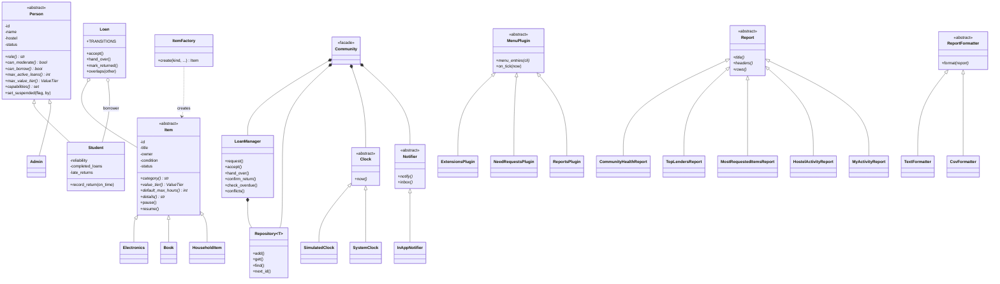
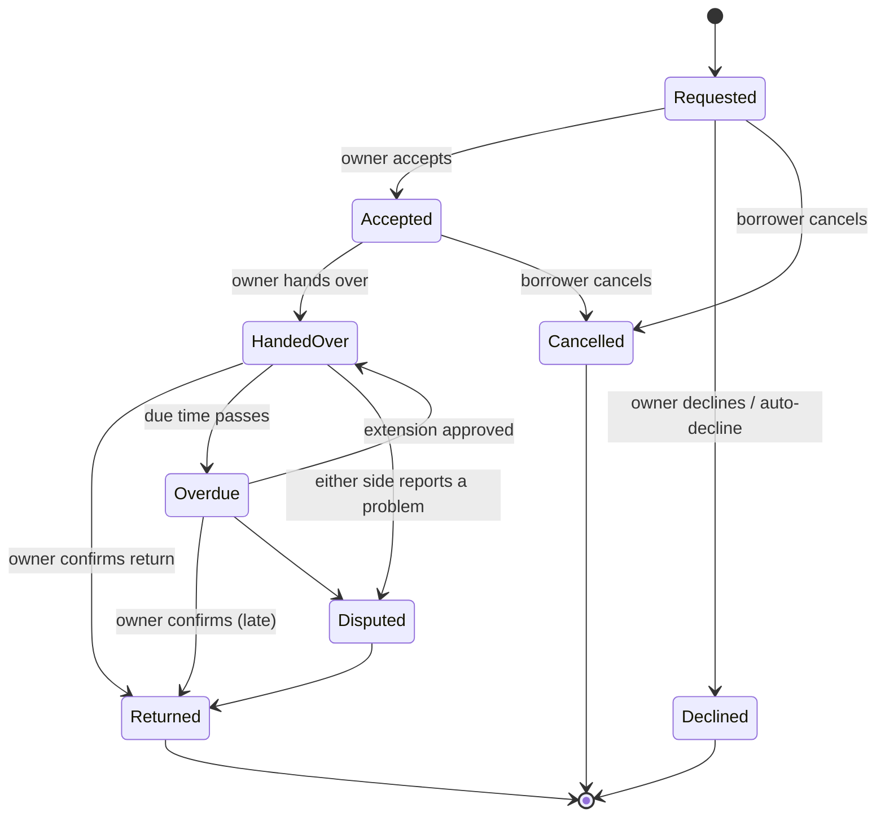

# BorrowMate

A peer-to-peer item borrowing system for university students living in hostels,
as a **menu-driven command-line app** in **pure Python 3.9+ (standard library only)**.

A student needs a calculator for an exam, an iron for 30 minutes, an extension
cable for 3 hours. Other students nearby own these and are not using them.
BorrowMate lets students list items, borrow them for an agreed time window, and
keeps a record of **who has what and when it must come back**.

It is a university group project, built to demonstrate every main OOP concept and
to let four students work in parallel (see [TEAM_PLAN.md](TEAM_PLAN.md) and [GITHUB_GUIDE.md](GITHUB_GUIDE.md)).

---

## Quick start

```bash
cd borrowmate
python main.py                                   # run with demo data
python -m unittest discover -s tests -t ..       # run all tests (92)
```

No `pip install` is needed. The demo clock starts at **Mon 10 Mar 2025, 09:00**
and can be moved forward from the menu (`clock`).

**Using the menu:** type either the **number** or the **[key]** shown next to an
entry (e.g. `3` or `taken`). Times accept `now`, `+2h`, `tomorrow 08:00` or
`YYYY-MM-DD HH:MM`. Errors never crash the app; they show as `! friendly message`.

> The test command must be run from inside the `borrowmate/` folder: `-t ..`
> makes the parent folder the import root, which is why the project folder has an
> `__init__.py`.

---

## Demo walkthrough (one story per user)

Log in by picking a user id. The seed data is built by a real scenario (requests,
accepts, hand-overs, clock moves), so every view has something to show at start-up.

| Id | Name | Role / trust | Hostel |
|----|------|--------------|--------|
| S1 | Amina  | Student, HIGH trust (rel. 4.2, 6 loans) | Mitchell Hall |
| S2 | Brian  | Student, MEDIUM (3.4, 3 loans)          | Lumumba Hall |
| S3 | Carol  | Student, MEDIUM (3.2, 2 loans)          | Nkrumah Hall |
| S4 | David  | Student, MEDIUM (3.6, 3 loans)          | Mitchell Hall |
| S5 | Esther | Student, HIGH (4.1, 6 loans)            | Lumumba Hall |
| A1 | Grace  | Admin                                   | Mitchell Hall |

What the start-up scenario created: the **Steam Iron** (I2) is out with Carol, due
back *in 2h 30m*; the **Extension Cable** (I3) is out with David and is **30m LATE**
(Overdue); Brian and Esther sent **two competing requests** (L3, L4) for Amina's
**Scientific Calculator** (I1); Esther has a **confirmed future booking** (L5) of
David's textbook; Esther's **Desk Fan** (I5) is **paused**.

**Amina (S1), the calculator's owner.** Pick `S1`, open `conflicts` to see the
`COMPETING` pair, then `approve`, `L3`. Brian's request is accepted and Esther's L4 is
**declined automatically** (check `conflicts` again: none left). Open `inbox` to see
the requests that arrived.

**Brian (S2), lender of the iron.** `taken` shows the countdown (`in 2h 30m`). Use
`clock`, `3`, then `taken` again: the iron is now `30m LATE`. As the owner, use
`return`, `L2`, `good`: only the owner can confirm a return, and Carol's reliability
drops by 0.5 because it was late.

**Carol (S3), lender of the cable and borrower of the iron.** `overdue` shows David's
cable. With the plugin entry `ext_decide`, approve David's extension request (see
David below). Carol can also `ext_ask` for extra time on the iron.

**David (S4), the overdue borrower.** `near` shows *Can I borrow?* = `No: You have an
overdue loan...` for every item. Use `ext_ask`, `L1`, `2` to ask Carol for 2 extra
hours. Once Carol approves, the loan is no longer Overdue and he can borrow again.

**Esther (S5).** `near` shows her trust level (HIGH) and each item's upcoming
bookings. She owns the paused fan: `pause`, `I5` resumes it. Try `need_post` to ask
for something nobody has listed ("I need this"), then switch to a student in range
and use `need_help` to offer it; Esther picks the offer with `need_mine`.

**Grace (A1), the admin.** Her menu has no borrowing entries (it is built from
capabilities, not role strings) but adds `disputes`, `suspend`, `restore`. Use
`reports` for community health, top lenders, most requested items, hostel activity
and CSV export.

---

## OOP concepts and where to find them

| Concept | Where it appears (exact classes) |
|---|---|
| **Abstraction** | `Person`, `Item` (models); `Clock`, `Notifier` (services); `Report`, `ReportFormatter`, `MenuPlugin` (plugins). All use `abc.ABC` + `@abstractmethod`; tests prove they cannot be instantiated. |
| **Inheritance** | `Student`, `Admin` extend `Person`. `Electronics`, `Book`, `HouseholdItem` extend `Item`. `SystemClock`, `SimulatedClock` extend `Clock`; `InAppNotifier` extends `Notifier`. Five report classes extend `Report`; `TextFormatter`, `CsvFormatter` extend `ReportFormatter`. `ValidationError`, `NotFoundError`, `PermissionDeniedError`, `EligibilityError`, `ConflictError`, `InvalidTransitionError` all extend `BorrowMateError`. |
| **Polymorphism** | `role()`, `can_moderate()`, `can_borrow()`, `max_active_loans()`, `max_value_tier()`, `capabilities()` on `Student`/`Admin`; `category()`, `value_tier()`, `default_max_hours()`, `details()` on the item subclasses; `format()` on the formatters; `title()`/`headers()`/`rows()` on every report. `CLI._visible_entries` builds the student and admin menus from `person.capabilities()`, with **no role-string comparison**. |
| **Encapsulation** | Private `_attributes` exposed through read-only `@property` on `Person`, `Student` (`reliability`, `completed_loans`), `Item` (`status`, `owner`), `Loan`, `Hostel`. State changes only through methods that enforce rules: `Student.record_return()` (clamped 0-5), `Item.pause()` (refuses when on loan), `Person.set_suspended()` (admins only), `Loan` transition methods. |
| **Composition** | `Community` (facade) owns the `Repository[Item]`, `Repository[Person]`, a `LoanManager`, a `Clock` and a `Notifier`. `LoanManager` owns a `Repository[Loan]`. `Loan` holds an `Item` and a borrower. |
| **Enums** | `Condition`, `ItemStatus`, `LoanStatus`, `UserStatus`, `ValueTier`, `ConflictSeverity`, `Capability`, plus `ExtensionStatus`, `NeedStatus`, `OfferStatus` in plugins. |
| **Generics** | `Repository[T]` (`services/repository.py`) |
| **Factory** | `ItemFactory.create(kind, ...)` (`models/item.py`) |
| **State machine** | `Loan.TRANSITIONS` table + `Loan.ensure_can_move_to()` raising `InvalidTransitionError` |
| **Strategy** | `ReportFormatter` -> `TextFormatter` / `CsvFormatter` |
| **Plugin / Open-Closed** | `MenuPlugin` auto-discovered by `plugins/loader.py` using `pkgutil` + `importlib` |
| **Dependency injection** | `Community(clock, notifier)`, `LoanManager(clock, notifier)`, `CLI(community, input_fn, output_fn, plugins)` |

---

## Class diagram



## Loan state diagram



(`HandedOver` is the status "Handed over" in the code; any move not in this table
raises `InvalidTransitionError`.)

---

## Business rules

**Privacy.** People are located by *hostel* only (never live GPS). Distance between
two people is the haversine distance between their hostels.

**Trust ladder (Student).** Reliability starts at 3.0: `+0.2` per on-time return,
`-0.5` per late return, clamped to 0-5.

| Level | Needs | May borrow | Active-loan limit |
|---|---|---|---|
| New | default | LOW value only | 1 (3 once 2+ loans completed) |
| Medium | reliability >= 3.0 and 2+ loans | up to MEDIUM | 3 |
| High | reliability >= 4.0 and 5+ loans | up to HIGH | 3 |

**Eligibility** (the refusal message always explains why). The borrower must be a
student; not suspended; not the owner; the item not paused; no overdue loans; under
the active-loan limit; the item's value tier within the trust level; start time not
in the past; hours within the item's maximum (electronics 24h, books 72h, household 6h).

**Conflicts.**
- `BLOCKED`: a new request overlapping a *confirmed* booking is refused, with the time the item is free.
- `COMPETING`: two *pending* requests may overlap; when the owner accepts one, the other is declined automatically.
- `CLASH`: two confirmed overlapping bookings are impossible through the rules, but would be reported.
- Back-to-back bookings (one ends when the next starts) are *not* an overlap.

**Accountability.** Only the item's **owner** can accept, decline, hand over and
confirm a return, so a borrower cannot fake a return. A return records on-time or late
plus the item's condition and updates the borrower's reliability. A handover cannot
happen before the booking's start time.

**Overdue.** Before every menu, loans past their due time become *Overdue* and both
people are notified. Overdue borrowers cannot make new requests.

**Notifications.** Every request, decision, handover, overdue warning, return and
dispute lands in an in-app inbox per user.

**Plugin rules.**
- *Extensions:* the borrower asks for 1-24 extra hours, **one request per loan**; the owner approves or declines **once**. Approval sets the new due time to `max(old due, now) + hours`, clears *Overdue*, and is refused if it would overlap the next confirmed booking. After a return, each side can rate the other once (1-5 stars); anyone can view a user's average.
- *"I Need This":* a student posts what they need, for how long and within what radius. Students in range are notified and may offer a listed item or an unlisted one. When the requester picks an offer, **all eligibility and conflict rules are checked first**; only then is the item listed (if needed) and a confirmed loan created. Other offers are declined. Unanswered requests expire after 24 hours.
- *Reports:* community health, top lenders, most requested items, hostel activity, my activity, shown as text or exported as CSV (strategy pattern).

---

## Project structure

```
borrowmate/
├── main.py                     # entry point
├── models/                     # what things ARE
│   ├── enums.py                # all statuses as Enums
│   ├── errors.py               # BorrowMateError hierarchy
│   ├── hostel.py               # Hostel + haversine distance
│   ├── person.py               # Person (abstract), Student, Admin
│   ├── item.py                 # Item (abstract), Electronics, Book, HouseholdItem, ItemFactory
│   └── loan.py                 # Loan state machine
├── services/                   # business RULES
│   ├── clock.py                # Clock (abstract), SystemClock, SimulatedClock
│   ├── notifier.py             # Notifier (abstract), InAppNotifier
│   ├── repository.py           # Repository[T]
│   ├── loan_manager.py         # eligibility, conflicts, accountability, overdue
│   ├── community.py            # facade: owns inventory, loans, clock, notifier
│   ├── seed.py                 # demo data + scenario
│   └── timefmt.py              # dates and countdown text
├── cli/                        # menus and display
│   ├── app.py                  # CLI class and the core menu
│   ├── menu.py                 # MenuEntry
│   ├── inputs.py               # parsing of typed input
│   └── tables.py               # aligned text tables
├── plugins/                    # optional features (one owner per file)
│   ├── base.py                 # MenuPlugin (abstract)
│   ├── loader.py               # auto-discovery with pkgutil + importlib
│   ├── extensions.py           # loan extensions and ratings
│   ├── need_requests.py        # "I Need This"
│   └── reports.py              # reports + Text/Csv formatters
└── tests/                      # unittest only
    ├── helpers.py              # small test world + ScriptedIO for the CLI
    ├── test_abstraction_polymorphism.py
    ├── test_models.py          # encapsulation, hostel, items, loan state machine, overlap
    ├── test_loan_rules.py      # eligibility, conflicts, accountability, overdue, search
    ├── test_plugin_discovery.py
    ├── test_plugin_extensions.py
    ├── test_plugin_needs.py
    ├── test_plugin_reports.py
    └── test_cli.py             # scripted CLI runs with injected input/output
```

### How to add a plugin (no merge conflicts)

1. Create a new file `plugins/my_feature.py`.
2. Subclass `MenuPlugin`, implement `menu_entries(cli)` returning `MenuEntry` objects (use `cli.community`, `cli.user`, `cli.ask()`, `cli.say()`, `cli.show_table()`).
3. Restart the app. The loader finds it and your entries appear in the menu. Nothing else is edited.

Set `capability=` on each `MenuEntry` (`BORROW`, `LEND`, `MODERATE`, `VIEW`) to decide who sees it.

---

## Running the tests

```bash
cd borrowmate
python -m unittest discover -s tests -t ..
```

The suite covers: abstract classes cannot be instantiated; polymorphic answers;
encapsulation (read-only properties, clamped score); every loan transition and every
illegal move; overlap logic (including back-to-back); each eligibility rule; conflict
detection and auto-decline; overdue handling; distance and radius search; each
plugin's rules; and scripted CLI runs using injected input and output.

---

## Team workflow (branches and pull requests)

Full split of work and suggested commit messages: **[TEAM_PLAN.md](TEAM_PLAN.md)**. Step-by-step GitHub instructions: **[GITHUB_GUIDE.md](GITHUB_GUIDE.md)**.

1. `main` is always runnable and its tests always pass. Nobody pushes to it directly.
2. One branch per person: `feat/models`, `feat/services`, `feat/cli-extensions`, `feat/needs-reports-docs`. Merge the pull requests in that order.
3. Commit small and often with prefixes `feat:`, `test:`, `docs:`, `refactor:`.
4. Before opening a pull request: `git pull --rebase origin main`, then run the tests.
5. Open a PR with a short description and the demo steps you tried. At least one teammate reviews it; the author merges once tests pass.
6. Everyone commits only the files they own (see the table in TEAM_PLAN.md), so PRs do not conflict. If you need a change in someone else's file, ask the owner or make a tiny separate PR first.

---

## Roadmap

- Save and load data (JSON files) so the community survives a restart.
- Real-time clock mode and scheduled reminders before the due time.
- Damaged-item handling: auto-pause an item returned as Damaged; admin dispute resolution.
- Deposit or "karma" points to complement the reliability score.
- Ratings feeding into the trust ladder.
- A web or mobile front-end that reuses `Community` unchanged.
- Item photos and categories, and a waiting list for popular items.
